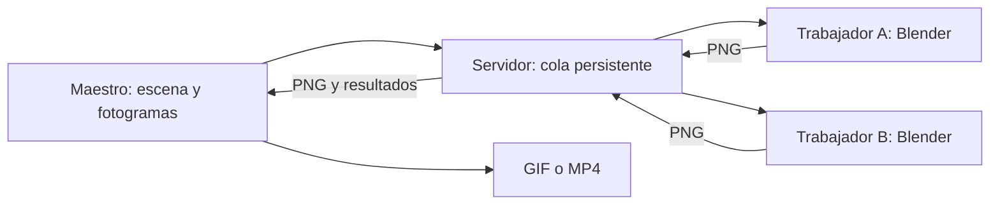

# Renderizador de animaciones 3D

Granja de renderizado distribuido para Programación de Servicios y Procesos. El proyecto genera fotogramas de una escena 3D mediante Blender y los reúne en una animación GIF o MP4. También permite conservar únicamente las imágenes PNG.

La arquitectura adapta la idea maestro–servidor–trabajadores de `UD6-Traca final`. Los tres programas pueden ejecutarse en un mismo ordenador o repartirse entre varios equipos de una red local. Se incluye una escena orbital de demostración y se admiten escenas propias en formato `.blend`.

## Funcionamiento

El proceso se divide en cinco pasos:

1. El maestro define la escena, el intervalo de fotogramas y los parámetros de renderizado.
2. El servidor conserva las tareas en una cola persistente y las distribuye entre los trabajadores disponibles.
3. Cada trabajador ejecuta Blender en segundo plano para renderizar un fotograma independiente.
4. Los trabajadores devuelven los PNG al servidor, que los valida, los guarda y los entrega al maestro.
5. El maestro ordena los fotogramas y monta la animación final.

Varios trabajadores pueden calcular distintos fotogramas de forma simultánea. Blender solo resulta necesario en los equipos que actúan como trabajadores.



La comunicación entre programas utiliza WebSocket. La cola del servidor y el registro del maestro se almacenan en SQLite. Las huellas SHA256 permiten comprobar los archivos transferidos y detectar copias dañadas.

## Resultados y configuración inicial

Cada ejecución permite obtener:

- Una animación GIF o, con FFmpeg, un vídeo MP4.
- Los fotogramas PNG numerados y ordenados.
- Un monitor web con progreso, trabajadores y vista del último fotograma disponible.
- Un CSV y un resumen JSON con tiempos, equipos y posibles errores.

Por defecto se renderizan **48 fotogramas a 24 FPS**, con una resolución de **640 × 360** y **16 muestras de Cycles**. La demostración representa una escultura de anillos y esferas en movimiento, creada por código.

La duración de reproducción se calcula mediante:

```text
duración en segundos = número de fotogramas / FPS
número de fotogramas = fin - inicio + 1
```

Por tanto, 48 fotogramas a 24 FPS producen una animación de 2 segundos. El tiempo necesario para calcularla depende de la escena, la resolución, las muestras y la capacidad de los equipos.

## Archivos del proyecto

| Archivo | Responsabilidad |
| --- | --- |
| `master.py` | Envío de la escena y los fotogramas, recepción de PNG, reanudación y montaje GIF/MP4. |
| `server.py` | Cola persistente, reparto de tareas, recuperación de interrupciones y monitor web. |
| `slave.py` | Ejecución de procesos de Blender en segundo plano y devolución de los renders. |
| `renderizar.py` | Construcción de la demo o apertura del `.blend` y renderizado de un fotograma dentro de Blender. |
| `protocolo.py` | Validación de parámetros, imágenes, identificadores y mensajes compartidos. |
| `requirements.txt` | Dependencias de Python: WebSockets y Pillow. |
| `tests/test_renderizador.py` | Pruebas de validación, persistencia, distribución y renderizado real opcional. |

## Requisitos

- Python 3.11 o posterior en los equipos que ejecuten los programas.
- Blender 4.5 LTS o posterior en los trabajadores. Se debe utilizar la misma versión en todos ellos para obtener resultados consistentes. La implementación se ha comprobado con Blender 4.5.16 LTS.
- FFmpeg para generar MP4; no se necesita para GIF ni para guardar PNG.

El motor utiliza **Cycles por CPU**, por lo que no se requiere GPU. El maestro y el servidor pueden funcionar sin Blender.

La instalación o versión portable de Blender puede obtenerse desde [su página de descargas](https://www.blender.org/download/). El argumento `--blender` admite la ruta completa al ejecutable. También se admite la variable de entorno `BLENDER_PATH` o un ejecutable disponible en el `PATH`.

## Preparación del entorno

Todos los comandos siguientes se ejecutan desde la carpeta `Renderizador de animaciones 3D`. La ruta del ejecutable de Blender debe ajustarse a la instalación existente.

### Linux

Creación del entorno e instalación de dependencias:

```bash
python3 -m venv .venv
.venv/bin/python -m pip install -r requirements.txt
```

Localización y comprobación de Blender:

```bash
which blender
.venv/bin/python slave.py --blender /usr/bin/blender --check
```

Si Blender se encuentra en otra ubicación, se utiliza la ruta obtenida. Como alternativa, se puede establecer en la terminal del trabajador:

```bash
export BLENDER_PATH='/ruta/a/blender'
```

### Windows PowerShell

Creación del entorno e instalación de dependencias:

```powershell
python -m venv .venv
.\.venv\Scripts\python.exe -m pip install -r requirements.txt
```

Si la instalación ofrece el lanzador `py`, el entorno también puede crearse con `py -3 -m venv .venv`. No se requiere activar el entorno, ya que los comandos utilizan directamente su ejecutable.

Comprobación de Blender con una ruta de ejemplo:

```powershell
.\.venv\Scripts\python.exe slave.py --blender "C:\Program Files\Blender Foundation\Blender 4.5\blender.exe" --check
```

También puede establecerse la variable en la terminal del trabajador:

```powershell
$env:BLENDER_PATH = 'C:\ruta\blender.exe'
```

## Primera animación en un solo ordenador

Se necesitan tres terminales abiertas en la carpeta del proyecto. El servidor y el trabajador deben permanecer en ejecución mientras el maestro distribuye el trabajo.

### Linux

Terminal 1: servidor.

```bash
.venv/bin/python server.py
```

Terminal 2: trabajador.

```bash
.venv/bin/python slave.py --name equipo-1 --blender /usr/bin/blender
```

Terminal 3: maestro.

```bash
.venv/bin/python master.py --run-id primera-orbita
```

### Windows PowerShell

Terminal 1: servidor.

```powershell
.\.venv\Scripts\python.exe server.py
```

Terminal 2: trabajador.

```powershell
.\.venv\Scripts\python.exe slave.py --name equipo-1 --blender "C:\Program Files\Blender Foundation\Blender 4.5\blender.exe"
```

Terminal 3: maestro.

```powershell
.\.venv\Scripts\python.exe master.py --run-id primera-orbita
```

### Seguimiento y salida

El monitor se encuentra en **http://127.0.0.1:8776**. Permite consultar el progreso, los trabajadores, el estado de cada fotograma y una previsualización. El WebSocket utiliza el puerto **8775**. Estos puertos permiten mantener el laboratorio de tráfico en sus puertos originales.

Al finalizar, la animación queda disponible en:

```text
resultados/primera-orbita/animacion.gif
```

Los PNG se guardan en `resultados/primera-orbita/fotogramas/`. El GIF se abre con un visor de imágenes o un navegador; el MP4, con un reproductor de vídeo.

Para una prueba inicial más ligera, se puede sustituir el comando del maestro por:

```bash
.venv/bin/python master.py --run-id prueba-rapida --end 12 --fps 12 --width 320 --height 180 --samples 4
```

En Windows, el mismo comando utiliza `.\.venv\Scripts\python.exe` en lugar de `.venv/bin/python`. Esta equivalencia se aplica a los ejemplos posteriores.

## Parámetros de renderizado y formatos

| Parámetro | Efecto |
| --- | --- |
| `--start 1 --end 96` | Renderizado de 96 fotogramas; a 24 FPS, cuatro segundos de animación. |
| `--width 1280 --height 720` | Mayor resolución y coste de renderizado. |
| `--samples 64` | Más muestras de Cycles; mayor calidad y tiempo de cálculo. |
| `--fps 30` | Cambio de la velocidad de reproducción; con los mismos fotogramas, cambia la duración. |
| `--format gif` | Montaje de una previsualización GIF; formato predeterminado. |
| `--format mp4` | Montaje de vídeo MP4 mediante FFmpeg. |
| `--format frames` | Conservación de los PNG y los informes, sin montar una animación. |
| `slave.py --slots 2 --threads 2` | Dos procesos de Blender simultáneos, con dos hilos CPU cada uno. |
| Otro trabajador | Capacidad adicional desde otro proceso o equipo. |

Para conservar la duración al aumentar los FPS, debe aumentarse también el número de fotogramas. Los límites son **1000 fotogramas consecutivos**, **3840 × 2160**, **512 muestras** y **60 FPS**.

GIF está orientado a previsualizaciones pequeñas y tiene un presupuesto de memoria de 128 MiB calculado como `anchura × altura × fotogramas × 4`. Admite 256 colores y tiempos en centésimas de segundo. Para animaciones grandes, mayor fidelidad o FPS precisos, se utiliza MP4 o la salida de fotogramas.

Ejemplo de salida MP4 con FFmpeg disponible en el `PATH`:

```bash
.venv/bin/python master.py --run-id orbita-hd --end 96 --width 1280 --height 720 --samples 64 --format mp4
```

Si FFmpeg no se encuentra en el `PATH`, se añade `--ffmpeg "/ruta/a/ffmpeg"`, o `--ffmpeg "C:\ruta\ffmpeg.exe"` en Windows. El montaje utiliza `libx264`. La anchura y la altura deben ser pares para MP4.

## Cambio de imagen o escena

La imagen mostrada en cada fotograma procede de una escena 3D renderizada. No existe una opción de entrada directa de JPG o PNG para convertir una fotografía en una animación 3D. El contenido puede cambiarse mediante un archivo `.blend` propio o modificando la demostración por código.

### Uso de una escena propia de Blender

1. Se crea o abre la escena en Blender.
2. Se comprueba que exista una cámara activa y que el encuadre, los materiales y la iluminación sean adecuados.
3. Se prepara la animación en el intervalo de fotogramas que se vaya a renderizar. Sin movimiento en la escena, los fotogramas mostrarán el mismo contenido.
4. Se empaquetan las texturas y demás recursos compatibles mediante **File → External Data → Pack Resources**.
5. Se guarda el archivo `.blend`.
6. Con el servidor y el trabajador en ejecución, se lanza el maestro con `--scene` y un identificador nuevo.

Ejemplo en Linux:

```bash
.venv/bin/python master.py --run-id mi-escena-1 --scene "/ruta/a/mi_escena.blend" --start 1 --end 48 --fps 24
```

Ejemplo en Windows:

```powershell
.\.venv\Scripts\python.exe master.py --run-id mi-escena-1 --scene "C:\escenas\mi_escena.blend" --start 1 --end 48 --fps 24
```

El maestro envía el archivo una vez al servidor, que lo distribuye a cada conexión de trabajador que lo necesite. No es necesario compartir rutas de disco entre equipos. El archivo se verifica mediante SHA256 y se conserva en la caché del trabajador.

Para utilizar una fotografía como textura o fondo, debe incorporarse a la escena en Blender y empaquetarse antes de guardar. El secuenciador y el compositor se desactivan durante el renderizado, por lo que la imagen debe formar parte de la escena renderizable, por ejemplo como textura de un plano.

El programa fuerza Cycles por CPU, resolución, muestras, FPS y salida PNG según los argumentos del maestro. El archivo `.blend` admite hasta **32 MiB** y cada PNG hasta **16 MiB**.

Solo deben utilizarse escenas propias o de confianza. La autoejecución de scripts está deshabilitada; los drivers Python y los recursos que dependan de scripts no están admitidos. Los recursos externos, las bibliotecas enlazadas y las cachés que no puedan empaquetarse en el `.blend` no se distribuyen automáticamente.

### Modificación de la demostración por código

La función `demo(bpy, phase)` de `renderizar.py` construye la escena orbital. Sus elementos principales son:

| Elemento | Código que controla su aspecto |
| --- | --- |
| Colores y materiales | Variables `teal`, `gold`, `silver`, `dark` y `floor`; valores RGB entre 0 y 1. |
| Formas y tamaños | Operaciones `primitive_uv_sphere_add`, `primitive_torus_add`, `primitive_cylinder_add` y `primitive_plane_add`. |
| Cámara y encuadre | `camera_add(location=(7, -10, 6.5))`, punto de enfoque y `camera.data.ortho_scale`. |
| Movimiento | Expresiones de posición y rotación que utilizan `phase`. |
| Iluminación | Posiciones, potencia, colores y tamaño de las luces de área. |

Por ejemplo, el material turquesa se define con:

```python
teal = material("Turquesa", (.025, .55, .47), .65, .23)
```

Para obtener un tono rojo, puede sustituirse el color RGB:

```python
teal = material("Rojo", (.8, .03, .02), .65, .23)
```

La variable `phase` recorre un ciclo a lo largo del intervalo solicitado. Por ello, al ampliar el número de fotogramas de la demo se reparte el mismo ciclo entre más imágenes. En una escena `.blend`, en cambio, se renderizan los fotogramas de su propia línea de tiempo.

Los cambios de `renderizar.py` deben copiarse a todos los trabajadores. Tras la actualización, se reinician los trabajadores y se inicia una ejecución con un identificador nuevo, por ejemplo `--run-id demo-modificada-1`. El identificador nuevo evita reutilizar resultados anteriores, ya que el código de la demo no forma parte de la huella de parámetros.

Para obtener una única imagen de una escena propia, puede utilizarse un intervalo de un solo fotograma y omitir el montaje:

```bash
.venv/bin/python master.py --run-id imagen-1 --scene "/ruta/a/mi_escena.blend" --start 1 --end 1 --format frames
```

La imagen quedará en `resultados/imagen-1/fotogramas/frame_000001.png`.

## Ejecución en varios equipos

En cada equipo se prepara la carpeta del proyecto y su entorno Python. En los trabajadores se instala también Blender. Todos los equipos deben disponer de versiones compatibles de los programas.

Se establece el mismo token en **cada terminal** que vaya a ejecutar un programa. En Linux:

```bash
export RENDER_TOKEN='pon-aqui-un-token-propio'
```

En Windows PowerShell:

```powershell
$env:RENDER_TOKEN = 'pon-aqui-un-token-propio'
```

El servidor se inicia escuchando en las interfaces de red:

```bash
.venv/bin/python server.py --host 0.0.0.0
```

En otro ordenador se arranca el trabajador, sustituyendo la IP por la del servidor y ajustando la ruta de Blender:

```bash
.venv/bin/python slave.py --server ws://192.168.1.50:8775 --name portatil-2 --blender /usr/bin/blender --slots 1 --threads 2
```

El maestro se conecta a la misma dirección:

```bash
.venv/bin/python master.py --server ws://192.168.1.50:8775 --run-id orbita-red
```

El monitor queda disponible en `http://IP-DEL-SERVIDOR:8776`. Se introduce el mismo token en su campo de conexión. El cortafuegos del servidor debe permitir los puertos elegidos. Esta versión utiliza WS y HTTP sin cifrar y está pensada para una red local de confianza; un despliegue público requiere TLS.

Se recomienda comenzar con un slot y dos hilos por trabajador. La concurrencia puede aumentarse tras observar el uso de CPU y memoria. También pueden ejecutarse varios trabajadores en el mismo ordenador, siempre que tengan nombres diferentes y exista capacidad suficiente.

## Archivos de salida y recuperación

```text
datos/
  maestro.sqlite3
  servidor/
    cola.sqlite3
    escenas/<sha256>.blend
    fotogramas/<run-id>/frame_000001.png
cache/
  escenas/<sha256>.blend
  logs/<asignacion>.log
resultados/<run-id>/
  fotogramas/frame_000001.png
  fotogramas.csv
  resumen.json
  animacion.gif                 O animacion.mp4, según --format
```

Estas rutas son las predeterminadas y se encuentran bajo la carpeta del proyecto. La salida `--format frames` conserva los PNG y los informes, sin GIF ni MP4.

- La repetición del mismo comando reanuda la ejecución; los PNG ya comprobados se reutilizan.
- Una ejecución nueva requiere otro `--run-id`. Los cambios de escena, intervalo, FPS, resolución o muestras también requieren otro identificador.
- Si se pierde un PNG del maestro, puede recuperarse de la copia persistida en el servidor.
- Si un trabajador se desconecta, sus asignaciones vuelven a la cola. Los latidos mantienen activos los renders largos y las respuestas de asignaciones caducadas se descartan.
- El servidor conserva los resultados después de recibir el acuse del maestro. Cada acuse pertenece a su animación.
- Tras tres intentos fallidos por defecto, se registra un fallo definitivo. El maestro exporta el informe y termina con código 1, sin montar una animación incompleta.
- Si falla únicamente el montaje, la repetición del comando reutiliza los PNG. Puede cambiarse entre `gif`, `mp4` y `frames` manteniendo el identificador y los parámetros de renderizado.
- `slave.py --timeout 600` limita cada fotograma a 600 segundos. `master.py --timeout 900` limita el intervalo sin resultados a 900 segundos, no la duración total del trabajo.

El campo `render_s_sum` representa la suma de los tiempos de renderizado de los trabajadores, incluido el arranque de Blender. `invocation_wall_s` mide la distribución y recepción en esa invocación del maestro; el montaje se realiza después. Una ejecución reanudada no representa una medición completa de rendimiento.

Para comparar uno y varios equipos deben mantenerse la escena, los fotogramas, las muestras, la resolución y las versiones de Blender, utilizando un identificador nuevo en cada ejecución.

## Comprobaciones ante incidencias

| Situación | Comprobación |
| --- | --- |
| No se encuentra Blender | Ruta de `--blender`, variable `BLENDER_PATH` o `PATH`; ejecución de `slave.py --check`. |
| Los fotogramas permanecen en cola | Existencia de al menos un trabajador conectado al mismo servidor. |
| No hay conexión desde otro equipo | IP del servidor, `--host 0.0.0.0`, token y permisos del cortafuegos. |
| Se rechaza un identificador | Uso de un `--run-id` nuevo si han cambiado los parámetros. |
| Se repite la demo anterior tras editarla | Actualización del código en todos los trabajadores y uso de otro identificador. |
| Falla un render de Blender | Mensaje del trabajador y registro correspondiente en `cache/logs/`. |
| Falla el montaje MP4 | Ruta de FFmpeg, disponibilidad de `libx264` y dimensiones pares. |
| Se supera el límite de memoria GIF | Menor resolución o número de fotogramas, o selección de `mp4` o `frames`. |

## Pruebas

En Linux:

```bash
.venv/bin/python -m unittest discover -s tests -v
```

En Windows PowerShell:

```powershell
.\.venv\Scripts\python.exe -m unittest discover -s tests -v
```

Las pruebas de renderizado real son opcionales y utilizan escenas pequeñas y carpetas temporales. Para incluirlas se establece la ruta de Blender antes de ejecutar la suite.

En Linux:

```bash
export BLENDER_TEST_PATH='/ruta/a/blender'
.venv/bin/python -m unittest discover -s tests -v
```

En Windows PowerShell:

```powershell
$env:BLENDER_TEST_PATH = 'C:\ruta\blender.exe'
.\.venv\Scripts\python.exe -m unittest discover -s tests -v
```

Para incluir la verificación MP4 se configura también `FFMPEG_TEST_PATH` con la ruta del ejecutable de FFmpeg.

## Referencias

- [Renderizado por línea de comandos de Blender](https://docs.blender.org/manual/en/latest/advanced/command_line/render.html).
- [Recursos empaquetados de Blender](https://docs.blender.org/manual/en/latest/files/blend/packed_data.html).
- [Documentación de FFmpeg](https://ffmpeg.org/ffmpeg.html).
