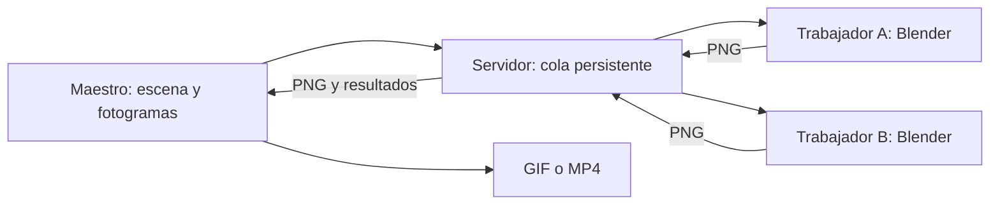

# Renderizador de animaciones 3D

Granja de render distribuida para Programación de Servicios y Procesos. El maestro divide una animación en fotogramas; el servidor los reparte entre equipos con Blender; cada trabajador devuelve PNG reales y el maestro monta la animación final.

Adapta la idea maestro–servidor–trabajadores de `UD6-Traca final`. Tiene una escena orbital de demostración y también acepta escenas `.blend` propias.

## Qué obtienes

- Una animación GIF que puedes abrir al terminar.
- Los fotogramas PNG numerados y ordenados.
- Un monitor web con progreso, trabajadores y una vista del último fotograma disponible.
- Un CSV y un resumen JSON con tiempos, equipos y posibles errores.
- Montaje MP4 opcional si dispones de FFmpeg.

Por defecto se renderizan **48 fotogramas a 24 FPS**, que forman una animación de **2 segundos**, a 640 × 360 y con 16 muestras de Cycles. La escena representa una escultura de anillos y esferas en movimiento.

La duración del vídeo se calcula como `número de fotogramas / FPS`. El tiempo real para renderizarlo depende de la escena, resolución, muestras y equipos disponibles.

## Archivos

| Archivo | Responsabilidad |
| --- | --- |
| `master.py` | Enviar la escena y los fotogramas, recibir PNG, reanudar y montar GIF/MP4. |
| `server.py` | Conservar la cola, distribuir tareas, recuperar interrupciones y mostrar el monitor. |
| `slave.py` | Lanzar procesos de Blender en segundo plano y devolver los renders. |
| `renderizar.py` | Script que ejecuta Blender para construir la demo o abrir el `.blend` y renderizar un fotograma. |
| `protocolo.py` | Validación de parámetros, imágenes, identificadores y mensajes compartidos. |



## Requisitos

- Python 3.11 o posterior en los equipos que ejecuten estos programas.
- Blender 4.5 LTS o posterior en los **trabajadores**. Utiliza la misma versión de Blender en todos ellos para obtener resultados consistentes. La implementación se ha comprobado con Blender 4.5.16 LTS.
- FFmpeg únicamente si eliges salida MP4.

El motor inicial utiliza **Cycles por CPU**. No necesitas GPU. El maestro y el servidor pueden funcionar sin Blender.

Puedes instalar Blender o descomprimir su versión portable desde [Blender](https://www.blender.org/download/). La opción `--blender` acepta la ruta completa a su ejecutable.

## Preparación en Windows

Desde esta carpeta:

```powershell
python -m venv .venv
.\.venv\Scripts\python.exe -m pip install -r requirements.txt
```

Si tu instalación ofrece `py`, puedes crear el entorno con `py -3 -m venv .venv`. Los comandos usan directamente su ejecutable y no requieren activar el entorno.

Comprueba la ruta de Blender; ajusta este ejemplo a tu instalación:

```powershell
.\.venv\Scripts\python.exe slave.py --blender "C:\Program Files\Blender Foundation\Blender 5.3\blender.exe" --check
```

También puedes configurar `$env:BLENDER_PATH = 'C:\ruta\blender.exe'` en la terminal del trabajador o añadir Blender al `PATH`.

## Primera animación

Abre tres terminales en esta carpeta.

Terminal 1: servidor.

```powershell
.\.venv\Scripts\python.exe server.py
```

Terminal 2: trabajador. Sustituye la ruta si es necesario.

```powershell
.\.venv\Scripts\python.exe slave.py --name equipo-1 --blender "C:\Program Files\Blender Foundation\Blender 5.3\blender.exe"
```

Terminal 3: maestro.

```powershell
.\.venv\Scripts\python.exe master.py --run-id primera-orbita
```

Abre **http://127.0.0.1:8776** para ver el progreso. Al terminar, abre **`resultados/primera-orbita/animacion.gif`**. Los puertos 8775 y 8776 permiten mantener también el laboratorio de tráfico en sus puertos originales.

Para una prueba más corta y ligera:

```powershell
.\.venv\Scripts\python.exe master.py --run-id prueba-rapida --end 12 --fps 12 --width 320 --height 180 --samples 4
```

## Aumentar el trabajo

| Parámetro | Efecto |
| --- | --- |
| `--end 96` | Más fotogramas; a 24 FPS, cuatro segundos de animación. |
| `--width 1280 --height 720` | Mayor resolución y coste de render. |
| `--samples 64` | Más muestras de Cycles; mejora la calidad y aumenta el cálculo. |
| `--fps 30` | Cambia la velocidad de reproducción; con los mismos fotogramas, cambia la duración. |
| `slave.py --slots 2 --threads 2` | Dos Blender simultáneos con dos hilos CPU cada uno. |
| Otro trabajador | Aporta capacidad desde otro proceso o desde otro equipo. |

Para conservar la duración al subir FPS, aumenta también el número de fotogramas. El límite inicial es de **1000 fotogramas**, resolución máxima de **3840 × 2160** y **512 muestras**.

GIF está orientado a previsualizaciones pequeñas y tiene un presupuesto de memoria de 128 MiB calculado sobre los fotogramas sin comprimir. Para animaciones grandes utiliza `--format mp4` o `--format frames`. GIF admite 256 colores y tiempos en centésimas de segundo; para mayor fidelidad y FPS precisos, utiliza MP4.

Ejemplo de una animación más grande, con FFmpeg disponible en el PATH:

```powershell
.\.venv\Scripts\python.exe master.py --run-id orbita-hd --end 96 --width 1280 --height 720 --samples 64 --format mp4
```

Si FFmpeg no está en el PATH, añade `--ffmpeg "C:\ruta\ffmpeg.exe"`. El montaje usa el codificador `libx264`, disponible en las compilaciones habituales de FFmpeg.

## Utilizar una escena propia

En Blender prepara la animación y una cámara activa. Empaqueta los recursos mediante **File → External Data → Pack Resources** y guarda el `.blend`.

```powershell
.\.venv\Scripts\python.exe master.py --run-id mi-escena --scene "C:\escenas\animacion.blend" --start 1 --end 48 --fps 24
```

El maestro envía el archivo una vez al servidor; este lo distribuye a cada conexión de trabajador que lo necesite. Los equipos no necesitan compartir rutas de disco. El archivo se verifica mediante SHA256 y se conserva en la caché del trabajador.

El `.blend` admite hasta **32 MiB** y cada PNG hasta **16 MiB**. Emplea escenas propias o de confianza. Blender se ejecuta con la autoejecución de scripts deshabilitada; los drivers Python y recursos que dependan de scripts no están admitidos por esta primera versión.

El programa fuerza Cycles por CPU, resolución, muestras, FPS y salida PNG según los argumentos. Desactiva compositor y secuenciador para renderizar la escena directamente. Los recursos externos, bibliotecas enlazadas y cachés de simulación que no se puedan empaquetar necesitan una ampliación del sistema de distribución de recursos. Las simulaciones físicas deben prepararse y hornearse de forma compatible antes de repartir fotogramas independientes.

## Varios equipos

En cada equipo prepara la carpeta y su entorno Python; en los trabajadores instala también Blender. Configura el mismo token en **cada terminal**:

```powershell
$env:RENDER_TOKEN = 'pon-aqui-un-token-propio'
```

Servidor:

```powershell
.\.venv\Scripts\python.exe server.py --host 0.0.0.0
```

Trabajador de otro ordenador; cambia la IP y la ruta de Blender:

```powershell
.\.venv\Scripts\python.exe slave.py --server ws://192.168.1.50:8775 --name portatil-2 --blender "C:\ruta\blender.exe" --slots 1 --threads 2
```

Maestro:

```powershell
.\.venv\Scripts\python.exe master.py --server ws://192.168.1.50:8775 --run-id orbita-red
```

El monitor está en `http://IP-DEL-SERVIDOR:8776`; utiliza el mismo token. El cortafuegos del servidor debe permitir los puertos elegidos. Esta versión usa WS y HTTP sin cifrar y está pensada para una red local de confianza; para un despliegue público necesitarías TLS.

Cada render consume recursos. Empieza con un slot y dos hilos por equipo; aumenta observando CPU y memoria. Evita asignar a un mismo equipo más renders simultáneos de los que puede sostener.

## Resultados y recuperación

```text
datos/
  maestro.sqlite3
  servidor/
    cola.sqlite3
    escenas/<sha256>.blend
    fotogramas/<run-id>/frame_000001.png
cache/
  escenas/<sha256>.blend
  logs/<asignacion>.log
resultados/<run-id>/
  fotogramas/frame_000001.png
  fotogramas.csv
  resumen.json
  animacion.gif                 O animacion.mp4, según --format
```

- Repite exactamente el comando para reanudar; los PNG ya comprobados no se renderizan otra vez.
- Para una ejecución completamente nueva, cambia `--run-id`. Cambiar resolución, escena o muestras requiere otro identificador.
- Si se pierde un PNG del maestro, se recupera de la copia persistida en el servidor.
- Si se desconecta un trabajador, sus asignaciones vuelven a la cola. Los latidos mantienen activos los renders largos; las respuestas de asignaciones caducadas se descartan.
- El servidor conserva los resultados después de recibir el acuse del maestro. Los acuses pertenecen a su animación.
- Tras tres intentos fallidos, se registra un fallo definitivo. El maestro exporta el informe y termina con código 1; no monta una animación incompleta.
- Si falla únicamente el montaje, repite el comando: se reutilizan los PNG. También puedes cambiar entre `gif`, `mp4` y `frames` sin cambiar el identificador si conservas los parámetros del render.
- `slave.py --timeout 600` limita cada fotograma. `master.py --timeout 900` limita el intervalo sin resultados; no limita la duración total del trabajo.

`render_s_sum` es la suma de los tiempos de render de los trabajadores, incluido el arranque de Blender. `invocation_wall_s` mide distribución y recepción en esa invocación del maestro; el montaje se realiza después. Una ejecución reanudada no sirve como medición completa de rendimiento.

Para comparar uno y varios equipos, conserva la escena, fotogramas, muestras, resolución y versiones de Blender, usando un nombre nuevo por ejecución.

## Pruebas

```powershell
.\.venv\Scripts\python.exe -m unittest discover -s tests -v
```

Para incluir las pruebas de render real, configura también la ruta de Blender:

```powershell
$env:BLENDER_TEST_PATH = 'C:\ruta\blender.exe'
.\.venv\Scripts\python.exe -m unittest discover -s tests -v
```

Las pruebas de render usan escenas pequeñas y carpetas temporales.
Para incluir la verificación MP4, configura también `FFMPEG_TEST_PATH` con la ruta al ejecutable de FFmpeg.

## Referencias

- [Render por línea de comandos de Blender](https://docs.blender.org/manual/en/latest/advanced/command_line/render.html).
- [Recursos empaquetados de Blender](https://docs.blender.org/manual/en/latest/files/blend/packed_data.html).
- [Documentación de FFmpeg](https://ffmpeg.org/ffmpeg.html).
