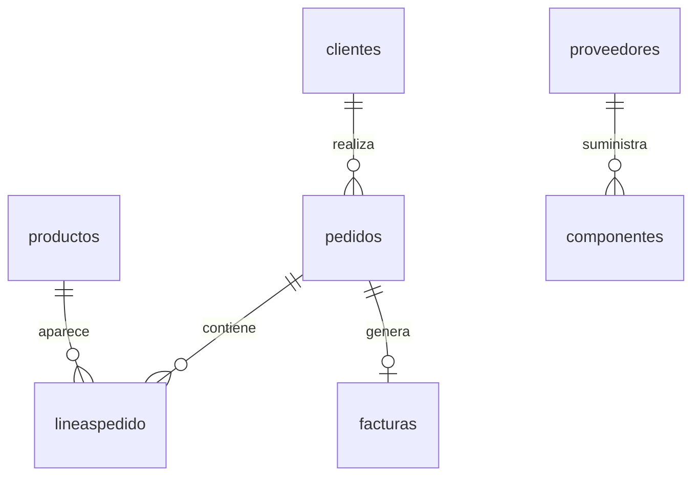

# Memoria del proyecto final · SGE / UD2

**Proyecto:** Purple Grape  
**Curso:** Desarrollo de Aplicaciones Multiplataforma  
**Unidad:** Instalación y configuración de sistemas ERP-CRM  
**Fecha:** 14 de octubre de 2026

## 1. Planteamiento

El supuesto es un pequeño estudio tecnológico que vende equipos y organiza su taller. Necesita registrar clientes, preparar pedidos, consultar existencias, relacionar componentes con proveedores, organizar al equipo y emitir facturas de ejemplo.

La versión anterior mostraba todas las tablas mediante un CRUD genérico. La nueva versión organiza las entidades en módulos funcionales, incorpora relaciones en los formularios y añade una vista general. La identidad pasa a llamarse «Purple Grape»: una marca de uvas, un menú ciruela, superficies lavanda y acentos violeta. Se mantiene «Estudio Alfredo» como firma personal. La web `estudio.html` presenta el proyecto académico y el panel `index.html` permite gestionar el supuesto.

## 2. Tecnologías y decisiones

| Tecnología propuesta | Decisión y justificación |
| --- | --- |
| HTML5, CSS3, JavaScript | Implementadas. HTML semántico, interfaz adaptable y operaciones `fetch` con JSON. No requieren compilación. |
| PHP | Backend implementado. Se adapta al entorno Apache y las extensiones SQLite ya están disponibles. |
| Node.js | Utilizado para comprobar la sintaxis de JavaScript. Un backend Node.js sería una alternativa a PHP; no hay un segundo servidor backend. |
| SQLite | Base implementada. Un archivo independiente facilita la instalación, la entrega y su apertura manual. |
| MySQL | Alternativa para una instalación LAMP clásica con más concurrencia. La migración exigiría adaptar esquema, vistas y conexión; no se presenta como implementada. |
| PostgreSQL | Alternativa relacional para mayores necesidades de concurrencia y control. No se utiliza en esta entrega. |
| MongoDB | Alternativa para información documental. Los pedidos y sus relaciones encajan mejor en un modelo relacional; no se añade una base NoSQL sin una necesidad concreta. |
| Apache y Linux | Entorno objetivo. Se entrega configuración de Apache y procedimiento de permisos. La verificación HTTP se ejecutó con el servidor de desarrollo PHP en Linux. |
| Cliente-servidor | Implementado: navegador → API PHP → SQLite. El cliente no accede directamente al archivo de datos. |
| LAMP | Se adopta su separación Linux/servidor web/PHP/datos, con SQLite en lugar de MySQL. Se documenta la diferencia con LAMP clásico. |
| Windows, Linux, macOS | El cliente usa un navegador moderno. No se verificaron navegadores en los tres sistemas; la compatibilidad necesita revisión manual. |

Las tecnologías de la propuesta se interpretan como opciones. Introducir varios motores de bases de datos y dos backends para el mismo prototipo dificultaría la instalación y no resolvería una necesidad del supuesto.

Se mantiene la separación entre núcleo y módulos: `api/nucleo.php` reúne funciones comunes y `api/modulos.php` declara entidades, tipos, etiquetas y perfiles. La API utiliza ese catálogo como lista cerrada de tablas y campos. Los módulos no son extensiones instalables de terceros: forman parte del código y se activan por configuración.

## 3. Módulos identificados — criterio a)

| Módulo | Entidades | Función |
| --- | --- | --- |
| Clientes / CRM | `clientes` | Datos de contacto y estados Activo, Potencial e Inactivo |
| Ventas | `pedidos`, `lineaspedido` | Relación con clientes y productos; cantidades y precios de venta |
| Inventario | `productos` | Catálogo, precios, existencias y stock mínimo |
| Compras | `proveedores`, `componentes` | Proveedores y piezas disponibles en el taller |
| Equipo / RR. HH. | `empleados` | Personas, departamentos, puestos y salario anual |
| Facturación | `facturas` | Factura relacionada con un pedido y registro de cobro |

El núcleo añade `configuracion`, `modulos` y `actividad`. El panel utiliza las vistas `resumen_pedidos` y `resumen_facturas` para calcular importes coherentes con las líneas.

## 4. Tipos de instalación — criterio b)

Se ofrecen dos canales de instalación y dos modalidades de datos:

1. **Consola:** `utilidades/instalar.php`. Recibe el perfil, el nombre y la opción `--vacia`.
2. **Web:** `instalador.html` llama a `api/instalar.php` mediante una sesión y token CSRF.
3. **Vacía:** crea esquema, configuración y registro de instalación; no inserta clientes, pedidos ni productos.
4. **Demostración:** crea el mismo esquema y añade los datos ficticios de `demo.sql`.

Las pruebas realizaron instalaciones vacías por consola en los tres perfiles, una instalación web con demostración, intentos de repetir la instalación y una instalación fallida por nombre inválido. El resultado correcto de un intento repetido es rechazarlo y conservar los datos. La instalación fallida revierte la transacción y elimina exclusivamente el archivo nuevo que acababa de crear.

La base de entrega se creó por consola con demostración y el perfil completo. El procedimiento Apache se proporciona para el despliegue local, pero no se ejecutó en la configuración global del equipo.

## 5. Configuración y supuestos — criterios c) y d)

Los ajustes guardan el nombre, el color hexadecimal y el perfil en SQLite. El catálogo de entidades define campos obligatorios, correos, fechas, relaciones, cantidades y estados disponibles.

| Supuesto | Perfil | Adaptación |
| --- | --- | --- |
| Estudio con taller y administración | Completo | Activa los seis módulos para gestionar la operación completa del supuesto |
| Oficina comercial de venta de equipos | Comercial | Activa CRM, ventas, inventario y facturación; oculta compras y equipo |
| Taller técnico con atención al cliente | Taller | Activa CRM, inventario, compras y equipo; desactiva ventas y facturación |

Cambiar el perfil no elimina registros. El menú muestra los módulos activos y la API rechaza el CRUD directo de módulos inactivos. Las referencias necesarias para relacionar entidades siguen siendo legibles. Esta configuración no sustituye permisos de acceso por usuario.

Se han probado los cambios de perfil y la conservación de los cinco clientes de demostración. La adaptación del taller se refiere a personas y componentes; no incorpora órdenes de reparación ni operaciones de compra completas.

## 6. Verificación del funcionamiento — criterio e)

Se verificaron la instalación, las lecturas de las ocho entidades, la creación de un flujo cliente-producto-pedido-línea-factura, la actualización del cliente y el cobro de una factura. También se verificaron los borrados y las relaciones.

Reglas del prototipo:

- Los totales de los pedidos se calculan desde sus líneas; no se introducen manualmente.
- Cada factura corresponde a un solo pedido, con IVA fijo del 21 %.
- La API bloquea los cambios del pedido y sus líneas cuando existe una factura.
- No se pueden borrar clientes, productos ni proveedores que siguen referenciados.
- Al borrar un pedido sin factura se eliminan sus líneas en cascada.
- Se rechazan correos duplicados, cantidades negativas, fechas inexistentes y estados ajenos al catálogo.
- Las escrituras usan consultas preparadas y exigen POST y token de sesión.
- El historial se guarda en la misma transacción que la operación.

El resultado inicial es **84 comprobaciones de integración correctas**. Se comprobó también la sintaxis de los archivos PHP y JavaScript, y la integridad del archivo SQLite entregado. Los límites de verificación se indican en `VERIFICACION.md`; no se afirma haber probado visualmente todos los navegadores.

## 7. Operaciones e incidencias — criterio f)

| Operación o incidencia | Resolución / evidencia |
| --- | --- |
| Módulos del menú anterior sin relación funcional con las tablas | Catálogo nuevo que organiza las ocho entidades en seis módulos |
| Configuración anterior en un archivo JSON con extensión PHP | Configuración persistida en SQLite y servida por la API |
| Instalador anterior que construía SQL a partir de texto libre | Esquema SQL controlado y validación de las opciones del instalador |
| Riesgo de perder la base anterior | Archivo `darkorange.db` conservado; base nueva `darkorange_alfredo.sqlite` |
| Importes introducidos manualmente | Vistas que suman las líneas y calculan IVA y total de factura |
| Escrituras desde otra página o peticiones incorrectas | Sesión, token CSRF, POST obligatorio y validación del servidor |
| El sandbox bloqueó los sockets necesarios para probar HTTP | Pruebas ejecutadas con autorización en un servidor temporal de localhost |
| Apache del equipo ignora `.htaccess` con `AllowOverride None` | Configuración de Apache preparada en `apache-darkorange.conf`; pendiente de aplicar por el administrador |
| Apache usa `www-data`, mientras la base se creó como `alfredo` | Procedimiento de grupo y permisos incluido en README; no se cambió la configuración global |
| No hay herramienta de control del navegador en esta sesión | Verificación HTTP y de sintaxis; revisión visual y compatibilidad de sistemas pendiente |

La tabla describe incidencias observadas y decisiones de implementación. El historial `actividad` registra instalaciones, configuraciones y cambios de datos; los errores SQL se escriben en el registro del servidor. Los errores rechazados no se registran como operaciones realizadas.

## 8. Alcance y mejoras posibles

Esta entrega permite gestionar el supuesto y revisar el modelo de datos. Las existencias se actualizan manualmente. Las facturas son registros de demostración: no incluyen PDF, numeración fiscal automática, abonos, descuentos ni varios tipos impositivos. Los cambios directos en SQLite pueden saltarse las reglas de negocio de la API.

Para una aplicación con acceso de varias personas se añadirían autenticación, permisos por usuario, gestión automática de stock, copias programadas y revisión fiscal. Una migración a MySQL o PostgreSQL requeriría un trabajo específico; disponer de PDO no hace automáticamente portable todo el SQL.

Fuentes utilizadas para confirmar las decisiones: [manual de PDO SQLite](https://www.php.net/pdo-sqlite), [claves foráneas SQLite](https://www.sqlite.org/foreignkeys.html), [transacciones PDO](https://www.php.net/pdo.transactions.php) y [uso de .htaccess en Apache](https://httpd.apache.org/docs/2.4/howto/htaccess.html).
