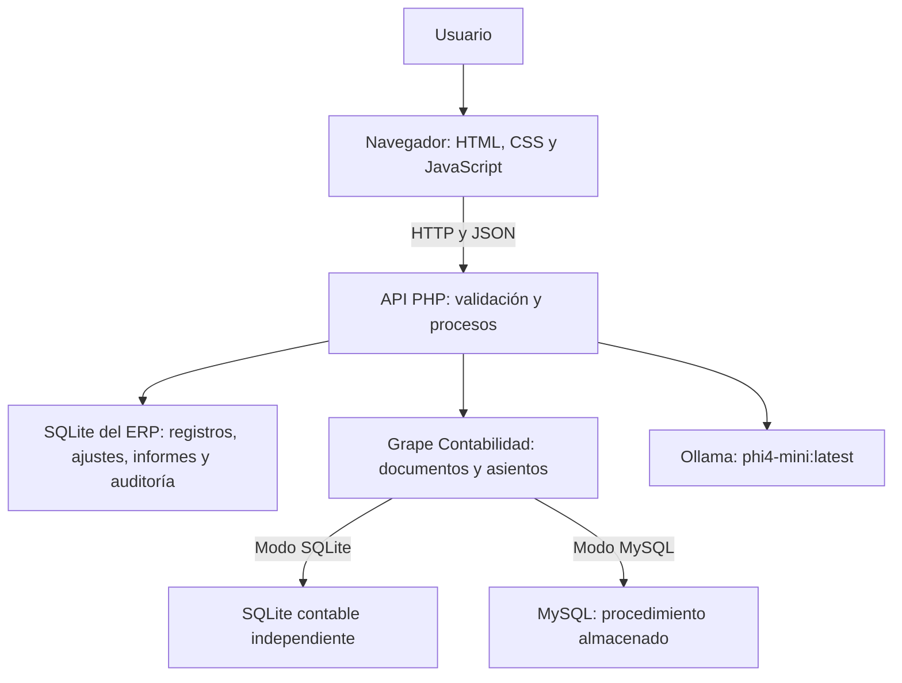

# Explicación de Purple Grape ERP/CRM

Este documento explica para qué sirve cada apartado de la aplicación, cómo realizar las operaciones habituales y por qué se utilizan sus tecnologías.

## 1. Qué es la aplicación

Purple Grape es una aplicación web de gestión empresarial. Parte del proyecto de la UD3 y conserva sus datos y gráficos, con la apariencia violeta de Basic Purple Grape. Esta versión incorpora las adaptaciones de la UD4.

El supuesto de trabajo es una empresa del sector aeronáutico que necesita gestionar clientes, productos, pedidos, proveedores, componentes y empleados.

La aplicación reúne funciones de dos tipos:

| Concepto | Qué significa | Cómo aparece en Purple Grape |
| --- | --- | --- |
| ERP | Sistema de planificación y gestión de los recursos de una empresa. | Productos, pedidos, componentes, proveedores, empleados y facturas. |
| CRM | Sistema de gestión de las relaciones con los clientes. | Fichas de clientes, segmentación y seguimiento de oportunidades comerciales. |

Los apartados comparten una base de datos. Por ejemplo, el cliente registrado en Ventas y CRM se puede seleccionar al crear un pedido. Sus líneas determinan el importe y, después, se puede generar una factura y enviarla a contabilidad.

## 2. Cómo ponerlo en marcha

La aplicación necesita ejecutar PHP para consultar y guardar los datos. Abrir index.html directamente como archivo no ejecuta esa parte del programa.

### 2.1. Entrar en la carpeta correcta

Antes de iniciar los servidores, se abre una terminal y se ejecuta:

~~~bash
cd "/var/www/html/DAM-2026/DAM-2026/1er TRIMESTRE/SISTEMAS DE GESTIÓN EMPRESARIAL/UD4-Implantación de sistemas ERP-CRM en una empresa/008-Proyecto-final-Purple-Grape-UD4"
~~~

Todos los comandos de arranque siguientes se ejecutan desde esta carpeta. Se puede comprobar que la carpeta de trabajo es correcta con:

~~~bash
pwd
ls router.php
~~~

### 2.2. Iniciar el ERP/CRM

~~~bash
php -S 127.0.0.1:8084 router.php
~~~

Después, se abre **http://127.0.0.1:8084/** en el navegador y se mantiene la terminal abierta.

La base data/purplegrape.db ya está incluida y preparada. No hay que reinstalarla para empezar.

Si ya se utiliza el ERP mediante Apache con PHP y la configuración del proyecto, se puede seguir accediendo por esa dirección.

### 2.3. Iniciar el sistema contable

Para enviar facturas hace falta el segundo servicio. Se abre otra terminal, se accede a la misma carpeta del proyecto y se ejecuta:

~~~bash
php -S 127.0.0.1:8085 router.php
~~~

También se mantiene esta terminal abierta. En **Integración contable**, se pulsa **Actualizar estado** y se comprueba que aparece **Conectado · sqlite**, o mysql si se ha configurado ese motor.

Se utilizan dos procesos porque el ERP envía una petición HTTP al sistema contable. El servidor PHP de desarrollo, en su configuración habitual de un solo proceso, no puede atender una segunda petición mientras está esperando que termine la primera.

Si se ejecuta el comando desde una carpeta como /home/alfredo, el servidor no encontrará el router.php del proyecto. Puede arrancar, pero devolver un error al intentar atender las peticiones.

## 3. Cómo moverse y trabajar con los registros

La primera columna contiene los módulos y herramientas. Al abrir un módulo de gestión, la segunda columna muestra sus entidades: por ejemplo, Clientes, Productos o Pedidos. El área principal muestra el formulario y los registros de la entidad seleccionada.

### Crear, editar y eliminar

En las entidades editables:

1. Se abre **Crear / editar registro**.
2. Se completan los campos. Los que llevan un asterisco son obligatorios.
3. Se pulsa **Crear registro**.
4. Para modificar una fila, se pulsa **Editar**, se cambian los datos y se utiliza **Guardar cambios**.
5. Se utiliza **Nuevo / Cancelar edición** para limpiar el formulario y empezar otro registro.
6. Para borrar una fila, se pulsa **Eliminar** y se confirma la acción.

El identificador se genera automáticamente. En los campos relacionados se selecciona un registro existente: por ejemplo, el cliente de un pedido o el proveedor de un componente.

La aplicación puede rechazar un borrado si existen registros que dependen de esa fila. Por ejemplo, un cliente con pedidos asociados mantiene esa relación.

Las facturas y las vistas SQL se gestionan mediante sus procesos o consultas y no muestran el formulario de edición habitual.

### Buscar, filtrar y exportar

Las tablas permiten buscar texto, seleccionar un campo y una condición, ordenar los resultados y, cuando corresponde, acotar fechas.

Las condiciones disponibles son:

| Condición | Uso | Ejemplo |
| --- | --- | --- |
| = | Buscar un valor igual al indicado. | Estado igual a Confirmado. |
| >= | Buscar un valor mayor o igual. | Stock mayor o igual a 20. |
| <= | Buscar un valor menor o igual. | Precio menor o igual a 100. |
| LIKE | Buscar un texto que contenga lo escrito. | Nombre que contenga Aero. |

Se pulsa **Aplicar consulta** para actualizar los resultados. Las tablas muestran 30 registros por página y tienen botones **Anterior** y **Siguiente**.

**Exportar consulta CSV** descarga los resultados de los filtros aplicados, hasta 10 000 filas. Si se cambia un filtro, se aplica antes de exportar.

## 4. Qué hace cada apartado del menú

### 4.1. Vista general

Es el panel de control de la aplicación. Permite consultar la situación del negocio mediante indicadores y gráficos calculados sobre los registros guardados.

Sus cuatro indicadores principales son:

| Indicador | Qué cuenta o suma |
| --- | --- |
| Clientes | Total de clientes registrados, incluidos los que estén marcados como inactivos. |
| Cartera de pedidos | Importe de los pedidos que no están en Borrador ni Cancelado. Incluye los entregados. |
| Oportunidades abiertas | Oportunidades que todavía no están Ganadas ni Perdidas. |
| Alertas de stock | Componentes cuyo stock es igual o inferior al stock mínimo. |

La cartera representa importes de pedidos registrados. El sistema no la utiliza para indicar cuánto dinero se ha cobrado.

El panel inicial contiene tarjetas con importes de pedidos por mes, estados de pedidos, recuentos por entidad y componentes con stock bajo. También se puede utilizar la fuente de ventas por cliente.

Cada tarjeta tiene un botón **Configurar**:

1. Se pulsa **Configurar**.
2. Se cambia su título.
3. Se selecciona la fuente de datos.
4. Se elige entre barras, tarta, anillo o tabla.
5. Se indica el ancho, de una a tres columnas.
6. Se pulsa **Guardar**.

Se puede utilizar **Añadir tarjeta** o eliminar alguna de las existentes. El panel admite entre una y doce tarjetas. En pantallas pequeñas, la distribución se adapta al espacio disponible.

Los cambios se guardan en la base de datos y se conservan al recargar. Los importes grandes pueden aparecer abreviados en los gráficos; las leyendas y los tooltips permiten consultar más detalle.

El importe mensual agrupa los pedidos por su fecha y excluye los cancelados. La cartera excluye además los borradores, por lo que ambos cálculos pueden dar sumas distintas.

### 4.2. Ventas y CRM

Agrupa las entidades relacionadas con los clientes y el proceso comercial.

#### Clientes

Guarda los datos de contacto: nombre, apellidos, país, teléfono y email. También permite asignar un segmento —Aerolínea, Distribuidor o Particular— e indicar si el cliente está activo.

Para utilizarlo, se crea primero la ficha del cliente. Después se puede seleccionar en sus pedidos y oportunidades.

La casilla Activo conserva una clasificación del cliente. El indicador general de clientes sigue contando todas las fichas registradas.

#### Productos

Contiene el catálogo de productos de la empresa. En este supuesto aparecen campos como nombre, tipo, precio, capacidad y autonomía.

El producto debe existir antes de añadirlo a una línea de pedido. Al crear la línea hay que indicar su precio unitario: esta versión no lo copia automáticamente desde el catálogo.

#### Pedidos

Registra una operación comercial con su fecha, cliente, estado, prioridad, notas y fecha de entrega.

Los estados disponibles son Borrador, Confirmado, En fabricación, Entregado y Cancelado. La prioridad puede ser Normal, Alta o Urgente.

El total se obtiene de las líneas del pedido:

~~~text
Importe de una línea = cantidad × precio unitario
Total del pedido = suma de los importes de sus líneas
~~~

El total no se modifica directamente desde el formulario. Se recalcula al insertar, cambiar o borrar líneas.

El botón **Calendario mensual** permite consultar los pedidos del mes seleccionado. Los coloca según el campo Fecha del pedido; la fecha de entrega se guarda como un dato separado.

Desde cada pedido también se puede pulsar **Emitir factura**, una vez revisadas sus líneas y su estado.

#### Líneas de pedido

Son los detalles de lo que se vende en cada pedido. Cada línea relaciona:

- Un pedido.
- Un producto.
- Una cantidad.
- Un precio unitario.

Un pedido puede tener varias líneas. Por ejemplo, dos unidades a 100 € y una unidad a 50 € producen un total de 250 €.

Para añadir una línea, se seleccionan el pedido y el producto, se completan la cantidad y el precio y se pulsa **Crear registro**.

#### Oportunidades

Permite seguir una posible venta antes de cerrarla. Guarda nombre, cliente, valor estimado, etapa, fecha de cierre y notas.

Las etapas son Contacto, Propuesta, Negociación, Ganada y Perdida. Por ejemplo, una renovación de flota puede empezar en Contacto y pasar a Propuesta cuando se envía una oferta.

Cambiar la etapa actualiza el seguimiento comercial. La creación del pedido se realiza aparte, desde Pedidos.

### 4.3. Compras y almacén

Agrupa proveedores y componentes.

**Proveedores** permite guardar nombre, país, especialidad y email. Estas fichas se seleccionan después en los componentes que suministra cada proveedor.

**Componentes** guarda nombre, tipo, proveedor, precio, stock disponible y stock mínimo.

El mínimo permite detectar qué componentes necesitan atención. Por ejemplo:

~~~text
Stock disponible: 16
Stock mínimo: 25
Resultado: aparece una alerta de stock
~~~

También se considera alerta cuando el stock coincide exactamente con el mínimo.

Para actualizar existencias, se edita el componente y se guarda su nuevo stock. El panel y la vista de alertas reflejarán ese valor al volver a consultarlos.

El alcance actual es el registro de proveedores y existencias. Los cambios en líneas de venta no descuentan automáticamente componentes y el módulo no genera órdenes de compra.

### 4.4. Personas

Permite mantener las fichas de los empleados: nombre, apellidos, departamento, puesto y salario.

Se utiliza con el mismo formulario de creación y edición que las demás entidades. También admite búsquedas, ordenación y exportación.

Por ejemplo, se puede filtrar el campo Departamento para consultar los empleados de Ingeniería o preparar un informe con nombre, departamento y puesto.

Esta versión gestiona los datos de las fichas; no incorpora cálculo de nóminas ni control horario.

### 4.5. Facturación

Muestra las facturas que ya se han emitido desde Pedidos.

Para generar una factura:

1. Se crea o se selecciona un pedido con líneas.
2. Se revisan los productos, cantidades y precios.
3. Se comprueba que esté Confirmado, En fabricación o Entregado.
4. Se pulsa **Emitir factura**.
5. Se accede a **Facturación** para consultarla.

La factura conserva su número, pedido de origen, cliente, fecha, base, IVA, total y estado de sincronización. El supuesto académico aplica un IVA fijo del 21 %.

Ejemplo:

| Concepto | Importe |
| --- | ---: |
| Base | 200,00 € |
| IVA del supuesto, 21 % | 42,00 € |
| Total | 242,00 € |

Al emitirla se conserva una copia de esos datos. El pedido y sus líneas quedan bloqueados para mantener la coherencia con la factura. Si se vuelve a pulsar Emitir factura para el mismo pedido, se recupera la factura existente.

Los estados de esta pantalla se refieren al envío contable:

| Estado | Significado |
| --- | --- |
| Pendiente | El ERP todavía no tiene confirmación de su sincronización contable. |
| Sincronizada | El sistema contable ha confirmado el registro y ha devuelto una referencia. |

Estos estados no indican si el cliente ha pagado.

**Enviar a contabilidad** realiza el intercambio con el segundo sistema. Una factura sincronizada muestra **Comprobar envío** para repetir la petición de forma idempotente, es decir, sin crear otro asiento para el mismo documento.

### 4.6. Informes

Permite preparar documentos de consulta con los datos de la empresa.

El **Informe completo** conserva el trabajo de UD3: incluye las entidades del ERP y sus gráficos de barras, tarta y anillo con el recuento de registros.

Para crear un informe personalizado:

1. Se selecciona el origen de los datos: una entidad o una vista SQL.
2. Se escribe el título.
3. Se marcan las columnas que se desean incluir.
4. Se configuran los filtros y la ordenación.
5. Se puede pulsar **Aplicar consulta** para comprobar cuántos registros coinciden.
6. Se pulsa **Guardar informe**.
7. Se abre el informe desde la lista de guardados.
8. Se utiliza **Imprimir / Guardar PDF** para imprimirlo o generar un PDF con el navegador.

Por ejemplo, se puede guardar un informe de empleados con nombre, departamento y puesto, filtrado por un departamento concreto.

Se guarda la definición de la consulta. Al abrir de nuevo el informe se consultan los datos actuales; el PDF que se haya generado conserva lo que mostraba en ese momento.

Eliminar un informe guardado borra su definición. Los registros de la entidad permanecen en su tabla.

Se admiten hasta 20 informes guardados. Los informes muestran hasta 10 000 registros por origen y avisan cuando hay más resultados.

### 4.7. Consultas y vistas

Permite trabajar con vistas SQL preparadas para relacionar o resumir los datos.

Una vista es una consulta guardada en la base de datos. Por ejemplo, puede unir pedidos con clientes para mostrar el nombre del cliente junto al importe.

Las vistas incluidas son:

| Vista | Qué muestra |
| --- | --- |
| v_pedidos_detalle | Pedido, fechas, estado, prioridad, cliente, total y número de líneas. |
| v_ventas_cliente | Cliente, país, segmento, número de pedidos e importe acumulado, con los cancelados excluidos del importe. |
| v_stock_alertas | Componentes con stock igual o inferior al mínimo y su proveedor. |
| v_facturas_estado | Número de facturas e importe agrupados por estado de sincronización. |

Para usarlas, se selecciona una vista, se ajustan los filtros y se pulsa **Aplicar consulta**. Se puede cambiar la ordenación, avanzar entre páginas y exportar el resultado a CSV.

Son pantallas de consulta. Los cambios en los datos se realizan desde la entidad correspondiente.

### 4.8. Adaptación

Permite ajustar la aplicación a otras necesidades de la empresa.

#### Seleccionar módulos

Se marcan los módulos que se desean mostrar en la navegación y se pulsa **Guardar módulos**. Debe quedar al menos uno seleccionado.

La selección controla qué módulos aparecen en el menú. Los registros se conservan y la selección no establece permisos por usuario.

#### Crear tablas propias

En **Crear una tabla**, se indica un nombre SQL, por ejemplo contratos, y se pulsa **Crear tabla**.

La nueva tabla incluye identificador, nombre y notas. Aparece en **Tablas propias** y después se puede ampliar con campos.

Los nombres SQL se escriben en minúsculas, sin espacios ni acentos. Pueden incluir números y guiones bajos, pero deben empezar por una letra.

#### Añadir campos

Para ampliar una entidad:

1. Se selecciona la tabla.
2. Se escribe el nombre SQL del campo, por ejemplo fecha_revision.
3. Se escribe la etiqueta que se mostrará, como Fecha de revisión.
4. Se elige el tipo de control.
5. Si se elige una lista, se indican las opciones separadas por comas.
6. Se pulsa **Añadir campo**.

Los tipos disponibles son Texto, Texto largo, Email, Fecha, Número decimal, Sí / No y Lista de opciones.

El campo se incorpora al formulario y la tabla, y queda disponible para consultas e informes. Los campos nuevos son opcionales para conservar la validez de los registros anteriores.

La adaptación no permite añadir campos a Facturas, porque esa entidad se genera mediante el proceso de emisión.

**Estructura y tipos de campo** permite consultar el nombre, tipo SQL, control de entrada y condición de edición de cada campo.

### 4.9. Integración contable

Conecta el ERP con **Grape Contabilidad**, el segundo sistema académico incluido en el proyecto. El receptor tiene su propio almacenamiento.

La pantalla permite comprobar la conexión, consultar facturas, enviarlas, revisar documentos recibidos y ver los saldos y el historial de sincronización.

El flujo de uso es:

1. Se inicia el servicio contable en su terminal.
2. Se pulsa **Actualizar estado**.
3. Se comprueba que aparece conectado.
4. Se selecciona una factura y se pulsa **Sincronizar**.
5. Se revisan su referencia externa y el documento del receptor.

En el ejemplo de una base de 200 €, IVA de 42 € y total de 242 €, se crean estos movimientos:

| Cuenta del supuesto | Debe | Haber |
| --- | ---: | ---: |
| 430 · Clientes | 242,00 € | 0,00 € |
| 700 · Ventas | 0,00 € | 200,00 € |
| 477 · IVA repercutido | 0,00 € | 42,00 € |
| **Total** | **242,00 €** | **242,00 €** |

El servicio comprueba que los importes cuadren. Para identificar un documento utiliza su origen y su número. Un reenvío con el mismo contenido recupera la referencia existente; un documento con esa identidad y otros datos se rechaza.

Si falla el envío, se consulta **Historial de sincronización**. Antes de reintentar, se comprueba que el servidor esté activo, que se haya iniciado desde la carpeta correcta y que la URL y la clave de integración coincidan con la configuración.

La integración es un envío entre aplicaciones por HTTP. Este botón no envía un correo al cliente.

El receptor puede utilizar SQLite o MySQL. Con MySQL ejecuta el procedimiento almacenado sp_contabilizar_factura, explicado en [docs/MYSQL.md](docs/MYSQL.md).

### 4.10. Asistente IA

Permite consultar el modelo **phi4-mini:latest** mediante Ollama para interpretar indicadores o proponer cambios en el panel.

Para realizar un análisis:

1. Se pulsa **Comprobar conexión**.
2. Se comprueba que el modelo está instalado.
3. Se escribe una pregunta, como «Analiza la evolución mensual de los pedidos».
4. Se pulsa **Consultar IA**.
5. Se revisan los datos verificados y la interpretación del modelo.

La consulta puede tardar hasta dos minutos. Se puede utilizar **Cancelar** para dejar de esperar esa petición en la interfaz.

El servidor prepara datos agregados: indicadores, importes mensuales, mes de mayor importe y recuentos por estado. No envía fichas individuales, emails ni salarios.

Para solicitar cambios en el panel:

1. Se marca **Permitir una propuesta para reorganizar el panel**.
2. Se describe el cambio: por ejemplo, «Cambia la tarjeta de estados de pedidos a barras y ocupa dos columnas».
3. Se revisa la propuesta mostrada.
4. Se pulsa **Aplicar propuesta** o **Descartar**.
5. Si se ha aplicado la propuesta y se desea restaurar el panel anterior, se utiliza **Deshacer cambio del panel** mientras se permanezca en esa vista.

La configuración de tarjetas se incorpora al contexto cuando se habilitan propuestas. El servidor valida las fuentes, tipos y tamaños antes de admitirlas.

Los indicadores verificados se calculan en el ERP. La interpretación es texto generado por el modelo y puede equivocarse, especialmente con cifras. Conviene contrastar ambos.

La IA no dispone de acciones para crear clientes, cambiar pedidos, emitir facturas o contabilizar. El historial de consultas no se guarda.

### 4.11. Operaciones

Muestra las últimas 100 operaciones que la aplicación ha registrado en su auditoría.

Cada entrada contiene identificador, fecha, acción, entidad, registro afectado y detalle. Las fechas de auditoría se guardan en UTC.

Permite comprobar, por ejemplo, cuándo se guardó un registro, se añadió un campo, se cambió el panel, se emitió una factura o se confirmó una sincronización.

El historial específico de intentos de envío, incluidos sus errores, se consulta en **Integración contable**.

La auditoría sirve para revisar lo que ha ocurrido. No permite deshacer automáticamente todas las operaciones y, en esta versión, no identifica a distintos usuarios porque la aplicación no incorpora acceso multiusuario.

## 5. Ejemplo de uso del ERP/CRM de principio a fin

Este recorrido utiliza datos de demostración que se pueden introducir desde la interfaz:

1. **Crear un cliente.** En Ventas y CRM → Clientes, se registra Cliente de demostración y sus datos de contacto.
2. **Crear un producto.** En Productos, se registra Producto de demostración con precio de 100 €.
3. **Crear un pedido.** Se selecciona ese cliente, se indica una fecha y se utiliza el estado Confirmado.
4. **Añadir una línea.** En Líneas de pedido, se seleccionan el pedido, el producto, cantidad 2 y precio unitario 100 €.
5. **Comprobar el total.** Se vuelve a Pedidos y se verifica que su total sea 200 €.
6. **Emitir la factura.** Se revisan las líneas y se pulsa Emitir factura. En este supuesto la base es 200 €, el IVA 42 € y el total 242 €.
7. **Enviar a contabilidad.** Se inicia el segundo servicio y se utiliza Enviar a contabilidad o Sincronizar.
8. **Comprobar el asiento.** Se revisan la referencia externa, el documento recibido y los movimientos de las cuentas 430, 700 y 477.
9. **Revisar el negocio.** Se abre Vista general y se consultan los indicadores.
10. **Preparar documentación.** Se crea un informe con los datos necesarios y se guarda como PDF.
11. **Consultar la auditoría.** Se revisan en Operaciones los registros generados por el proceso.

La emisión deja bloqueado el pedido, por lo que los productos, cantidades y precios se revisan antes de facturarlo.

## 6. Por qué los importes se guardan en céntimos

Las facturas y los movimientos contables guardan sus importes como números enteros que representan céntimos.

| Importe mostrado | Entero almacenado |
| --- | ---: |
| 100,00 € | 10000 |
| 42,00 € | 4200 |
| 242,00 € | 24200 |

La conversión es:

~~~text
Céntimos = redondear(euros × 100)
Euros para mostrar = céntimos / 100
~~~

Esta decisión permite sumar y comparar los importes de los documentos con enteros. Algunos decimales no tienen una representación exacta en coma flotante; por ejemplo, una operación informática con 0.1 y 0.2 puede producir 0.30000000000000004.

En cambio, 10 céntimos más 20 céntimos se pueden sumar como 10 + 20 = 30.

En esta versión, los precios y totales de pedidos conservan el tipo REAL heredado de UD3 y se redondean a dos decimales. Al emitir la factura se convierten a céntimos enteros. Esa distinción explica por qué algunos campos técnicos terminan en _centimos, aunque la tabla los presente con formato de euros.

## 7. Tecnologías y lenguajes utilizados

La aplicación separa la interfaz del navegador, la lógica del servidor y los datos persistentes.

### 7.1. HTML: estructura de las pantallas

HTML organiza la página: cabecera, navegación, formularios, botones, tablas y secciones.

Se utiliza porque el navegador interpreta esos elementos directamente y permite emplear etiquetas adecuadas para cada función, como label para los campos y table para los registros.

El punto de entrada es [index.html](index.html). La página de informes está en [nucleo/reporting.html](nucleo/reporting.html).

### 7.2. CSS: apariencia y adaptación a pantallas

CSS define colores, tipografía, espacios, bordes, tamaños y distribución.

Permite conservar el violeta de Purple Grape y adaptar el diseño a ordenador y móvil. Se utilizan Grid, Flexbox y reglas de medios para reorganizar la navegación, los formularios y las tarjetas según el ancho disponible.

También hay estilos de impresión para preparar los informes. El archivo principal es [estilo.css](estilo.css).

### 7.3. JavaScript: interacción en el navegador

JavaScript atiende los clics, muestra cada vista, construye formularios y tablas, dibuja gráficos y comunica la interfaz con el servidor mediante fetch.

Permite consultar y actualizar contenido sin cargar una página HTML nueva para cada operación. Las respuestas llegan de forma asíncrona: la interfaz puede mostrar que está cargando mientras espera al servidor.

Se utiliza JavaScript sin un framework de interfaz para mantener la continuidad del proyecto y hacer visibles sus componentes:

| Archivo | Función |
| --- | --- |
| codigo.js | Navegación y comportamiento de las pantallas. |
| nucleo/formulario.js | Controles generados a partir de metadatos. |
| nucleo/tabla.js | Tablas y acciones sobre registros. |
| nucleo/graficas.js | Gráficos SVG. |
| nucleo/reporting.js | Preparación de informes en el navegador. |

Los textos de los registros se insertan con textContent para que se traten como texto al mostrarse en la página.

### 7.4. PHP: lógica de negocio y API

PHP se ejecuta en el servidor. Recibe las peticiones del navegador, valida datos, consulta la base y aplica los procesos de la empresa.

Se utiliza porque continúa la arquitectura de las versiones anteriores, funciona con el entorno PHP/Apache del proyecto y dispone de las herramientas necesarias para acceder a SQLite, MySQL y servicios HTTP.

La validación se repite en el servidor aunque el formulario ya tenga controles. Esto permite comprobar los datos recibidos antes de guardarlos.

La organización principal es:

| Archivo | Responsabilidad |
| --- | --- |
| api/superapi.php | Recibir las rutas de la API y devolver las respuestas. |
| api/metadatos.php | Catálogos, estructura, controles, validación y consultas. |
| api/procesos.php | Guardado, adaptación, panel, facturación y sincronización. |
| api/bootstrap.php | Conexiones, transacciones, sesiones, auditoría y peticiones HTTP. |
| api/ia.php | Preparar agregados y consultar Ollama. |
| config/aplicacion.php | Leer la configuración del servidor. |

### 7.5. SQL y SQLite: datos, relaciones y cálculos

SQL permite crear tablas, consultar registros, relacionarlos y obtener resúmenes.

SQLite es el motor utilizado por el ERP. Guarda los datos en data/purplegrape.db y facilita el arranque académico porque no requiere instalar un servidor de base de datos separado.

Los datos se organizan con relaciones. Por ejemplo, cliente_id relaciona un pedido con un cliente y pedido_id relaciona una línea con su pedido.

También se utilizan:

- **Vistas**, para guardar consultas que unen o resumen datos.
- **Índices**, en campos usados para localizar pedidos y relaciones.
- **Triggers**, para ejecutar cálculos o bloqueos al cambiar los datos.
- **Transacciones**, para confirmar juntas las operaciones de un proceso o revertirlas si falla.
- **Claves foráneas**, para mantener relaciones entre registros existentes.

Los triggers recalculan los totales y bloquean cambios en los pedidos facturados. Las transacciones mantienen juntas operaciones como emitir una factura y registrar su auditoría.

La elección de SQLite se ajusta al uso local de este proyecto. No supone que se hayan probado las mismas condiciones que tendría un ERP con muchos usuarios simultáneos.

### 7.6. PDO: conexión de PHP con la base de datos

PDO es la interfaz de acceso a datos utilizada desde PHP.

Permite preparar consultas SQL y enviar los valores como parámetros. Por ejemplo, un nombre de cliente se envía como un dato de la consulta.

Los nombres de tablas y columnas se contrastan con las entidades y campos permitidos. Así se separan las partes estructurales de la consulta de los valores introducidos por el usuario.

Se utiliza PDO tanto para el SQLite principal como para el receptor MySQL opcional, aunque cada motor conserva sus características y su SQL específico.

### 7.7. MySQL: procedimiento almacenado del sistema contable

MySQL es un motor opcional para Grape Contabilidad. El ERP principal sigue utilizando SQLite.

Se incluye para ejecutar el procedimiento almacenado nativo **sp_contabilizar_factura** dentro del servidor de base de datos. El procedimiento valida el documento, abre una transacción, controla duplicados e inserta los movimientos.

Esto permite demostrar la adaptación de procedimientos almacenados del criterio g. Los triggers de SQLite y una rutina nativa de MySQL son mecanismos distintos.

El arranque normal utiliza SQLite. Para activar MySQL hay que preparar su base y configurar las variables indicadas en [docs/MYSQL.md](docs/MYSQL.md).

### 7.8. HTTP, JSON y cURL: comunicación entre partes

Estas tecnologías permiten que la interfaz, el ERP y los servicios intercambien información:

| Elemento | Papel en la aplicación |
| --- | --- |
| HTTP | Transporta peticiones y respuestas entre navegador y servidor, o entre servicios. |
| JSON | Organiza los datos enviados: campos de un registro, indicadores, facturas o propuestas. |
| fetch | Realiza las peticiones HTTP desde JavaScript. |
| cURL | Realiza las peticiones HTTP desde PHP hacia contabilidad y Ollama. |

Por ejemplo, al crear un cliente, JavaScript envía un objeto JSON a la API PHP. PHP valida sus campos, guarda el registro y devuelve una respuesta que la interfaz puede interpretar.

Al sincronizar una factura, PHP envía otro JSON al receptor contable. La clave de integración se incorpora en esa comunicación entre servidores.

Esta separación permite mantener el receptor y su almacenamiento independientes del ERP.

### 7.9. SVG: gráficos e icono de la aplicación

SVG es un formato vectorial utilizado para las barras, tartas, anillos y el icono de uvas.

Los gráficos se construyen desde JavaScript a partir de datos del servidor. El navegador los dibuja con formas y texto, y permite añadir tooltips y descripciones.

Se utiliza para conservar los gráficos de UD3, adaptarlos al tamaño de la pantalla y evitar una dependencia externa para representarlos.

### 7.10. Ollama y phi4-mini:latest: asistencia con IA

Ollama proporciona el servicio que carga y ejecuta el modelo. **phi4-mini:latest** es el modelo fijado para esta versión.

PHP prepara el contexto y lo envía a Ollama. La conexión se realiza desde el servidor, por lo que el navegador no tiene que llamar directamente al servicio de IA.

El modelo ayuda a interpretar los agregados y a proponer configuraciones de tarjetas. La respuesta se pide con un esquema JSON y se comprueba antes de mostrar o aceptar una propuesta.

Ollama puede estar en el equipo o en un servidor accesible por red, según OLLAMA_URL. La aplicación usa inicialmente http://10.0.2.2:11434.

Las consultas habituales, los gráficos, las facturas y los registros funcionan con independencia de que el servicio de IA esté disponible.

### 7.11. CSV y PDF: salida de información

CSV permite exportar registros en un formato tabular que se puede abrir en una hoja de cálculo.

PDF permite conservar o compartir la presentación de un informe. En esta aplicación se genera mediante la función de impresión del navegador, con estilos preparados para ese uso.

La exportación CSV neutraliza textos que empiecen por caracteres de fórmula para reducir el riesgo de que se interpreten como fórmulas al abrir el archivo.

### 7.12. Python, Node.js y Playwright: comprobación del proyecto

Son herramientas utilizadas para verificar la aplicación:

| Herramienta | Para qué se utiliza |
| --- | --- |
| Python | Ejecutar pruebas HTTP, preparar copias temporales y comprobar datos e integridad. |
| Node.js | Comprobar la sintaxis de JavaScript y ejecutar las pruebas de navegador. |
| Playwright y Chromium | Probar clics, formularios, informes, propuestas de IA y adaptación a móvil. |

PHP sirve la aplicación y JavaScript se ejecuta en el navegador. Node.js y Playwright no forman parte del arranque normal del ERP.

Las pruebas de escritura trabajan sobre copias temporales. Algunas comprobaciones esperan los datos iniciales de la entrega, por lo que deben ejecutarse con una copia adecuada si ya se ha personalizado la base.

## 8. Cómo se relacionan las partes

Por ejemplo, al pulsar Guardar cambios, el navegador envía los campos a PHP. PHP comprueba sus tipos y relaciones, guarda la operación en una transacción y responde. JavaScript actualiza la tabla con los datos que devuelve el servidor.

Los formularios utilizan metadatos: información sobre el nombre, tipo y condiciones de cada campo. Esa es la razón por la que un campo añadido en Adaptación puede aparecer después en el formulario y las consultas sin programar una pantalla completa para él.

## 9. Protección y alcance de la versión

Las peticiones de escritura utilizan una sesión y un token CSRF para comprobar que proceden de la sesión de la aplicación. El receptor contable exige una clave de integración.

router.php protege las rutas de datos, configuración y otros archivos internos en el servidor de desarrollo. En Apache se utilizan las reglas de .htaccess.

Estas medidas acompañan a la validación y a las restricciones de la base. La versión está pensada para la demostración académica local y no incorpora autenticación ni roles multiusuario. Los módulos seleccionados en Adaptación controlan la navegación.

## 10. Problemas frecuentes

| Situación | Qué comprobar |
| --- | --- |
| Se abre el HTML, pero no carga datos. | Se accede por el servidor HTTP con PHP y no directamente como archivo. |
| No se confirma el envío contable. | Se inicia el segundo servicio desde la carpeta del proyecto y se revisan Actualizar estado e Historial de sincronización. |
| El servicio devuelve un error de servidor al arrancar con router.php. | Se comprueba la carpeta de trabajo con pwd y que exista router.php. |
| El calendario no muestra pedidos. | Se selecciona un mes con pedidos y se revisa su campo Fecha. |
| No se puede editar un pedido. | Se comprueba si ya tiene una factura emitida. |
| No se puede borrar una fila. | Se revisa si otros registros están relacionados con ella. |
| El modelo de IA no responde. | Se revisan la conexión con Ollama, su URL y la instalación de phi4-mini:latest. |
| Un campo nuevo no aparece en una pantalla ya abierta. | Se vuelve a entrar en la entidad para cargar su estructura actualizada. |
| El CSV no coincide con el filtro que se acaba de escribir. | Se pulsa Aplicar consulta antes de exportar. |

Para ampliar la información:

- [Arranque y configuración del proyecto](README.md).
- [Arquitectura y API](docs/ARQUITECTURA.md).
- [Evidencias de los criterios RA4](docs/RA4.md).
- [Modo MySQL y procedimiento almacenado](docs/MYSQL.md).
- [Pruebas e incidencias observadas](docs/PRUEBAS-E-INCIDENCIAS.md).

